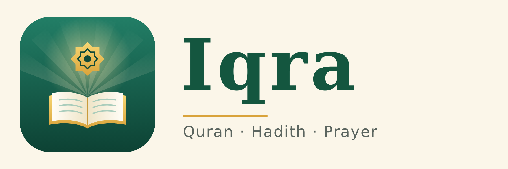

# Iqra – কুরআন ও সুন্নাহ

*Iqra (اقرأ) means "Read" — the first word revealed in the Quran.*

Iqra is a free Islamic app for iPhone. It was made so that everyone can read and learn about their deen with comfort, including people with dyslexia and other reading difficulties.

**Open the app:** https://rahimachy26.github.io/Iqra/

## The Holy Quran
Read by **surah** (all 114, with English and Bangla names) or by **para** (all 30). Search for any surah by name, meaning or number, and star your favourite surahs to find them quickly. Before each surah that has an authentic virtue, a short **Benefits · ফজিলত** box explains it in English and Bangla, with the hadith reference (for example, reading Surah Al-Kahf on Friday). Only narrations from Bukhari, Muslim, or graded sahih/hasan are included.

All 30 paras of the Quran in clear Arabic (Uthmani script), with the Bangla translation under every verse. Each surah has a heading with its name and number of ayahs. The app remembers where you stopped, so you can carry on from the same verse next time. Paras you have opened are saved on your phone and can be read without internet.

## Hadith: Sahih al-Bukhari
All 97 books of Sahih al-Bukhari, with each hadith in Arabic, English and Bangla. You can search for a topic such as Prayer, Fasting or Knowledge, and switch each language on or off.

## Prayer times
The five daily prayers and sunrise for over 100 countries, or for your own location. A countdown shows the next prayer, and a weekly timetable helps you plan ahead. You can choose the calculation method and the Asr timing (Standard or Hanafi) to match your local mosque.

## Learn: Ramadan, Laylatul Qadr, the Quran and Zakat
Short, authentic lessons in English and Bangla, each with its source (hadith linked to sunnah.com, Quran verses open inside the app):
- **Benefits of Ramadan** · **Laylatul Qadr** (with the dua taught to Aisha RA) · **How the Quran came** · **Benefits of reading the Quran** · **Zakat**
- **Zakat calculator**: silver or gold nisab, today's price per gram, savings, gold, investments, business stock, money owed and debts, plus a fitrana calculator.

## Daily check · আত্মসমালোচনা (30 days)
A private 30-day self-review (muhasaba). Each day: the five prayers (on time / late / missed), total rakats, Quran, hadith, sunnah prayers, adhkar, charity, kindness to family, guarding the tongue, one good deed, one thing you're grateful for and one thing to improve tomorrow. You get a daily score, a 30-day colour calendar, a streak, progress stats, a daily evening reminder and a Share button. Everything stays on your phone.

## Reminders
Add alerts for the five daily prayers, sehri and iftar in Ramadan, and a weekly Friday reminder to read Surah Al-Kahf. They go into your iPhone Calendar, so they ring even when the app is closed.

## Ramadan
A countdown to the next Ramadan, today's sehri and iftar times, and a full month's timetable for your city. Short explanations in English and Bangla cover fasting, Taraweeh, Laylatul Qadr, I'tikaf, Zakat al-Fitr and Eid.

## Designed for easy reading
- Soft background colours: cream, blue, green, peach, yellow or dark
- Adjustable text size, Arabic size and line spacing
- Extra letter and word spacing
- Reading-friendly fonts
- A reading ruler that dims the rest of the page
- Focus mode, which shows one verse or hadith at a time

## How to install
Open the app link in Safari on your iPhone, tap **Share**, then **Add to Home Screen**. It opens full screen like any other app.

## Sources
- Quran text (Uthmani) and Bangla translation: [Al-Quran Cloud API](https://alquran.cloud/api)
- Sahih al-Bukhari (Arabic, English by Muhsin Khan, Bangla): [Hadith API by Fawaz Ahmed](https://github.com/fawazahmed0/hadith-api)
- Prayer times are calculated on the device (based on the PrayTimes.org method). Times may differ by a few minutes from your local mosque's timetable.

May Allah make it a source of benefit for all who use it. 🤲
